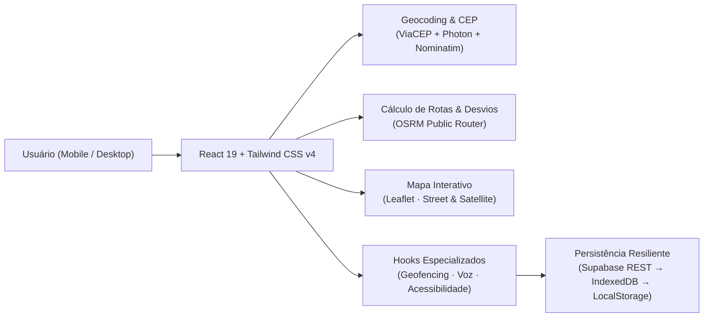

<div align="center">

<br />


# SafeRoute &middot; CitizenTech São Paulo

**Rotas que avisam antes do risco.**

*Navegação urbana preventiva para São Paulo que compara o trajeto mais rápido com um desvio seguro e dispara alertas estilo Defesa Civil quando você se aproxima de uma área crítica.*

<br />

[](https://react.dev/)
[](https://www.typescriptlang.org/)
[](https://tailwindcss.com/)
[](https://vitejs.dev/)
[](https://leafletjs.com/)
[](LICENSE)

<br />

**[Explorar Arquitetura](#-arquitetura-e-fluxo)** &nbsp;&middot;&nbsp; **[Experiência Mobile & UX](#-experiência-uxui-mobile-first)** &nbsp;&middot;&nbsp; **[Acessibilidade Universal](#-acessibilidade-universal)** &nbsp;&middot;&nbsp; **[Rodar Localmente](#-como-executar-localmente)**

---

</div>

## Sobre o Projeto

Quem dirige ou utiliza aplicativos de transporte em **São Paulo** conhece o dilema diário entre **chegar rápido** e **evitar pontos vulneráveis**. Aplicativos tradicionais otimizam apenas o tempo de viagem — muitas vezes guiando motoristas diretamente por cruzamentos de semáforos lentos com alto índice de *quebra de vidro*, abordagens da gangue do celular ou alagamentos históricos.

O **SafeRoute CitizenTech** traz a lógica preventiva dos alertas de emergência da **Defesa Civil (SMS 40199)** para dentro da navegação curva a curva: antes e durante o percurso, o sistema analisa zonas críticas georreferenciadas, calcula um **desvio seguro monitorado**, orienta por voz em português e notifica antes que o veículo entre na área de atenção.

> [!NOTE]
> Este é um protótipo funcional de demonstração (*CitizenTech*). Os dados de risco, zonas de atenção e mensagens de alerta são simulados para demonstrar o fluxo completo de georreferenciamento, cálculo de desvios e acessibilidade em interface urbana.

---

## Principais Capacidades

| Pilar | Como funciona na prática |
| :--- | :--- |
| **Comparação de Rotas Reais (OSRM)** | Traça automaticamente até **3 alternativas** entre qualquer endereço ou CEP em São Paulo: **Rota Segura (Desvio Recomendado)**, **Rota Mais Rápida** e **Rota Alternativa**. |
| **Geofencing & Auto-Desvio** | Monitora em tempo real a distância entre o veículo e zonas críticas (como **Santa Ifigênia**, **Sé**, **Brás**, **Glicério**, **Paulista/Consolação** e **Capão Redondo**). No modo mobile com **`Auto ON`**, redireciona automaticamente para a rota segura ao se aproximar do risco. |
| **Modo Rua & Satélite (Sem API Key)** | Alterna instantaneamente entre **Modo Rua** (Esri *World Street Map* com fallback em malha viária de São Paulo integrada) e **Modo Satélite** limpo com fotografia aérea real (*World Imagery*) e identificação de bairros/vias. |
| **Reportes Livres em Toda São Paulo** | Permite registrar ocorrências em **qualquer bairro ou avenida de SP** — com campo de digitação livre apoiado por **75+ bairros, vias, marginais e pontes catalogadas** (Centro, Zonas Sul, Oeste, Leste e Norte) + geocodificação automática. |
| **Voz & Alerta Acústico** | Síntese de voz nativa em `pt-BR` (*Web Speech API*) integrada com alerta sonoro sintetizado (*Web Audio API*) ao cruzar perímetros críticos. |
| **Design Monocromático Editorial** | Interface de alta precisão em **preto, branco e tons neutros**, com tipografia de destaque **Syne**, texto **Plus Jakarta Sans** e telemetria **JetBrains Mono**. |

---

## Experiência UX/UI Mobile-First

Pensado prioritariamente para quem usa no smartphone durante deslocamentos, o SafeRoute oferece dois modos de visualização selecionáveis em qualquer dispositivo:

1. **`Mapa` (Experiência Uber / Google Maps / Waze)**
   - **Busca em 1 toque (`Para onde você vai?`)** com botão dedicado de **GPS instantâneo** no topo da barra e preenchimento automático por CEP (*ViaCEP*) ou endereço (*Photon / Nominatim*).
   - **Troca rápida de rota** direto na base do mapa com nota de segurança (`/100`), distância (`km`) e tempo (`min`).
   - **Seção dedicada e contrastada abaixo do mapa** (acima do rodapé) separando **Detalhes**, **Passo a Passo** e **Alertas**.
   - **Telas isoladas em `100dvh`**: abrir **Acessibilidade**, **Diretrizes da Defesa Civil** ou **Reportar** ocupa a tela dedicada sem vazar ou sobrepor elementos do mapa ao fundo.

2. **`Modo Celular` (Simulador Interativo no Próprio Dispositivo)**
   - Permite visualizar e testar o comportamento dentro de um chassi interativo de smartphone — útil tanto para demonstrações em desktop quanto para inspeção mobile.

---

## Acessibilidade Universal

Construído para ser confortável para pessoas com baixa visão ou sensibilidade visual, sem quebrar o layout:

- **Escala completa de fonte (`14px` · `16px` · `18px` · `20px`)**: o ajuste em **`A++ (20px)`** escala proporcionalmente desde títulos e cartões até rótulos menores e os **protocolos completos de prevenção das Diretrizes da Defesa Civil** (como o *Protocolo de Prevenção à Gangue do Celular*).
- **Adaptação automática de contêineres**: barras, botões, alturas de mapa (`rem`) e painéis expandem e quebram linha de forma fluida em celulares e desktops no tamanho máximo.
- **3 Modos de Exibição**: **Claro**, **Noturno** e **Aparelho** (acompanha o tema do sistema operacional automaticamente).
- **Alto Contraste + Navegação por Teclado**: foco visível reforçado e contraste acentuado sob demanda.

---

## Arquitetura e Fluxo



### Estrutura do Código (`src/`)

```text
src/
├── components/
│   ├── AccessibilityMenu.tsx    # Painel de Acessibilidade (Portal mobile 100dvh + desktop)
│   ├── ExpandedMapWorkspace.tsx # Mapa amplo interativo (Desktop)
│   ├── Footer.tsx               # Rodapé institucional, stack e atribuições
│   ├── IncidentList.tsx         # Listagem, filtros, confirmação e foco no mapa
│   ├── IncidentReportModal.tsx  # Cadastro livre para qualquer bairro/via de São Paulo
│   ├── MobileMapExperience.tsx  # Experiência mobile estilo Uber/Waze/Google Maps + Auto-Desvio
│   ├── MobilePhoneSimulator.tsx # Protótipo interativo em moldura de smartphone
│   ├── Navbar.tsx               # Barra superior responsiva
│   ├── NavigationMap.tsx        # Motor Leaflet (Rua, Satélite, marcadores e zonas)
│   ├── RouteItinerary.tsx       # Guia curva a curva sincronizado ao progresso
│   ├── RouteSelector.tsx        # Planejador de origem/destino, GPS e comparativo
│   └── SafetyTipsDrawer.tsx     # Diretrizes da Defesa Civil SP & telefones de emergência
├── data/
│   ├── mockData.ts              # Zonas críticas (incl. Capão Redondo), rotas e diretrizes
│   └── saoPauloLocations.ts     # 75+ bairros, avenidas, marginais e pontes de SP
├── hooks/
│   ├── useAccessibility.ts      # Tema (Claro/Noturno/Aparelho), fonte (14–20px) e contraste
│   ├── useGeofenceAlert.ts      # Detecção de proximidade em metros com perímetros de risco
│   ├── useRouteNavigation.ts    # Simulação de trajeto, ETA, velocidade e cálculo OSRM
│   ├── useSafetyAlerts.ts       # CRUD de ocorrências + promoção automática de zonas críticas
│   └── useVoiceGuidance.ts      # Síntese de voz pt-BR + áudio alerta Web Audio API
└── services/
    ├── api.ts                   # Camada unificada com fallback offline
    ├── db.ts                    # Armazenamento IndexedDB local
    ├── routingService.ts        # ViaCEP, Photon, Nominatim, OSRM e instruções passo a passo
    └── supabase.ts              # Cliente Supabase opcional
```

---

## Como Executar Localmente

### Pré-requisitos
- **Node.js 18+**
- **npm**

### Passo a Passo

```bash
# 1. Clone o repositório
git clone https://github.com/ninixzzs/saferoute-citizentech.git

# 2. Entre na pasta do projeto
cd saferoute-citizentech

# 3. Instale as dependências
npm install

# 4. Inicie o ambiente de desenvolvimento
npm run dev
```

Para gerar e validar o bundle de produção com verificação estrita de tipos (`tsc && vite build`):

```bash
npm run build
npm run preview
```

---

## Autoria, Atribuições & Licença

- **Front-end Design & Web Development:** **Nicolly Vilela (Tech Lead)** &middot; [@ninixzzs](https://github.com/ninixzzs)
- **Repositório:** [ninixzzs/saferoute-citizentech](https://github.com/ninixzzs/saferoute-citizentech)
- **Mapas & Dados Abertos:** Mapa &copy; OpenStreetMap &middot; &copy; CARTO &middot; Esri Imagery &middot; Rotas OSRM &middot; CEPs ViaCEP
- **Licença:** Distribuído sob a licença **MIT**. Consulte [LICENSE](LICENSE) para detalhes.
